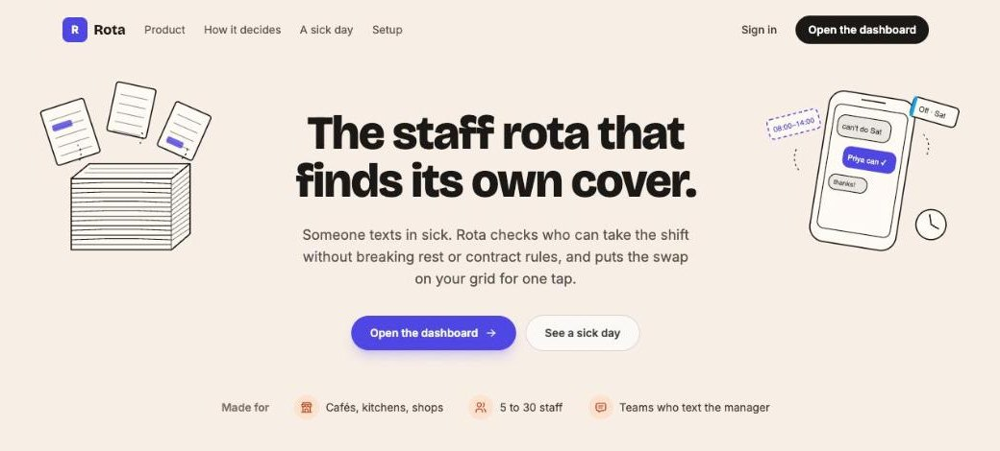
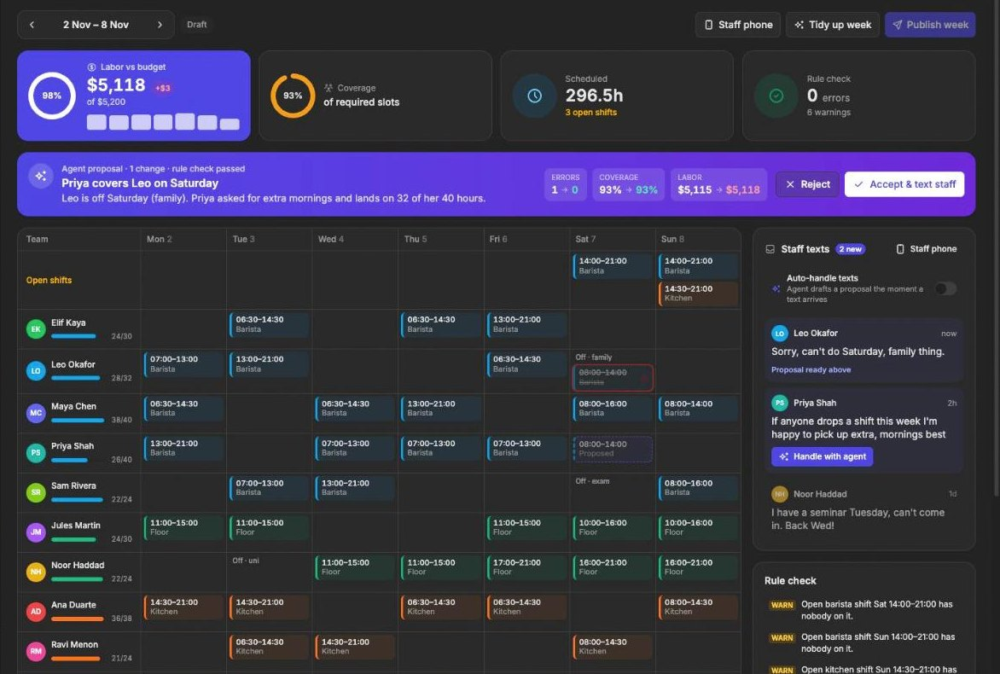
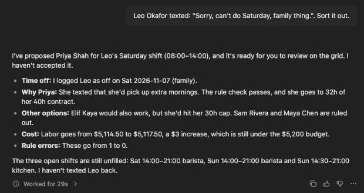
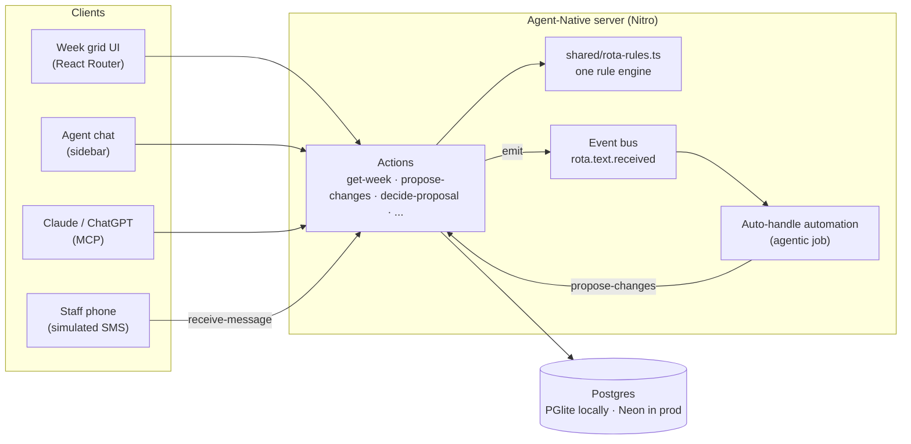

<div align="center">

# Rota

**The staff rota that finds its own cover.**

Someone texts in sick. Rota checks who can take the shift without breaking rest or contract rules,<br>
and puts the swap on your week grid for one tap.

[](https://rota-shifts-pi.vercel.app)
[](https://agent-native.com)
[](https://reactrouter.com)
[](https://neon.tech)
[](https://rota-shifts-pi.vercel.app)

[Live demo](https://rota-shifts-pi.vercel.app) · [How it works](#how-a-sick-day-goes) · [Quick start](#quick-start) · [Architecture](#architecture)



</div>

---

## Contents

- [Why Rota](#why-rota)
- [How a sick day goes](#how-a-sick-day-goes)
- [Features](#features)
- [The rules](#the-rules)
- [Quick start](#quick-start)
- [Try it in 2 minutes](#try-it-in-2-minutes)
- [Architecture](#architecture)
- [Actions](#actions)
- [Use it from Claude or ChatGPT](#use-it-from-claude-or-chatgpt)
- [Deploy](#deploy)
- [Project layout](#project-layout)
- [Known limits](#known-limits)
- [Credits](#credits)

## Why Rota

Small cafés, kitchens and shops build their rota in a spreadsheet and fix it by text message. When someone calls in sick at 6am, the manager has to work out who's free, who's close to their contract hours, and who'd get less than 11 hours between shifts. That takes about twenty minutes and is easy to get wrong.

Rota does that part. The agent reads the text, logs the day off, ranks who can cover, and drafts the swap. A rule engine decides whether the swap is allowed. The manager taps **Accept** and the affected staff get a text.

**The agent can suggest. Only you can accept.**

## How a sick day goes



| Time | Who | What happens |
|-|-|-|
| 06:12 | Leo | Texts: *"Sorry, can't do Saturday, family thing."* |
| 06:12 | Agent | Marks Leo off Saturday and tries the barista team against the rules. |
| 06:13 | Rule check | Priya fits. Sam would go over his 24h contract. Maya would be double-booked. |
| 06:13 | Grid | Priya's shift appears as a dashed **Proposed** chip. Leo's shift is struck through. The banner shows errors 1 → 0 and labor +$3. |
| 07:05 | You | Tap **Accept & text staff**. Priya and Leo get a text. |

With **Auto-handle** on, the agent starts the moment the text arrives, with no chat open. With it off, click **Handle with agent** on the text.

<details>
<summary><b>What the agent actually wrote</b> (real reply from the live demo)</summary>
<br>

</details>

## Features

| | |
|-|-|
| **Week grid** | Staff down the side, days across, shifts colored by role. Drag a shift to move or reassign it and see the rule result before you let go. |
| **Agent proposals** | Changes from the agent land as dashed ghost shifts with a banner showing errors, coverage and labor before → after. One pending proposal per week. |
| **Staff texts** | An inbox of inbound texts with status chips: new, proposal ready, handled. A **Staff phone** simulator lets you text in as any staff member. |
| **Auto-handle** | An event-triggered automation (`rota.text.received`) drafts a proposal in the background, about 20 to 40 seconds after a text. |
| **Rule check** | Live list of errors and warnings, and a stat card that goes red when a hard rule fails. |
| **Publish** | Blocked while a proposal is pending or any hard rule fails. Publishing texts every staff member their week. |
| **Team** | Hours rings, cost and days off per person. Edit rates and contract hours inline. |
| **Rules page** | Coverage needed per role and hour, plus the weekly labor budget. |
| **Dashboard stats** | Labor vs budget ring, coverage ring, scheduled hours, rule check count. |
| **Phone width** | Every screen works at 390px. |

## The rules

One file, [`shared/rota-rules.ts`](shared/rota-rules.ts), judges every change, whether it comes from a drag, a server action or the agent.

| Rule | Type | Example message |
|-|-|-|
| No double-booking | Error | Maya Chen is double-booked Sat. |
| No shift on a day off | Error | Leo Okafor is off Sat (family). |
| 11 hours rest between shifts | Error | Leo Okafor gets 9.5h rest between Tue and Wed (needs 11h). |
| Never over contract hours | Error | Sam Rivera is at 30.0h, over their 24h contract. |
| Coverage per role and hour | Warning | Sat 16:00: 0 of 1 barista on. |
| Weekly labor budget | Warning | Labor is $120 over the $5,200 budget. |
| Overtime past 40h | Warning | Tom Becker is at 42.5h (overtime past 40h). |
| Shift length 3 to 10 hours | Warning | Jules Martin's Sat shift is 10.5h (over 10h). |
| Open shifts | Warning | Open barista shift Sat 14:00–21:00 has nobody on it. |

Errors stop a change. `propose-changes` rejects a plan that adds an error with `rule_violation`, and the agent tries another person. Direct edits only go through with `force: true`, which the UI offers as **Place anyway** after you confirm.

## Quick start

**Requirements:** Node 22.22+, pnpm 10 (`corepack enable`), and an Anthropic API key for the agent.

```bash
git clone https://github.com/codeswithroh/rota.git
```

```bash
cd rota && pnpm install
```

```bash
pnpm dev
```

The app opens at http://localhost:8080 with a local PGlite database, so there's nothing else to set up. Open the agent panel and click **Connect AI** to add your Anthropic key, or put it in `.env.local`:

```bash
ANTHROPIC_API_KEY=sk-ant-...
```

Other scripts:

| Command | What it does |
|-|-|
| `pnpm typecheck` | Type-check the app |
| `pnpm build` | Production build |
| `pnpm agent-native:doctor` | Check the app against framework rules |

## Try it in 2 minutes

1. Open `/` and click **Open the dashboard**. Create an account.
2. Click **Load demo café**: 10 staff, 45 shifts, a $5,200 budget and two texts waiting.
3. Drag one of Maya's shifts onto Leo's row. The toast explains which rule it breaks.
4. Click **Staff phone**, pick Leo, send *"Can't do Saturday, kid is sick."*
5. Click **Handle with agent** (or turn on **Auto-handle** first and just wait).
6. Check the dashed shift and the banner, then click **Accept & text staff**.
7. Open **Inbox** to see the texts Rota sent, then **Publish week**.

## Architecture



- **One set of actions.** The grid, the agent chat, the background automation and MCP clients all call the same actions in [`actions/`](actions). Nothing has a private write path.
- **One rule engine.** [`shared/rota-rules.ts`](shared/rota-rules.ts) runs in the browser (drag preview) and on the server (every write).
- **Proposals, not writes.** The agent changes shifts through `propose-changes`, which stores ghost changes. `decide-proposal` applies them after re-running the rule check. The agent only calls it when you tell it to in chat, and the background automation never does.
- **Context.** `view-screen` gives the agent the current week, the selected shift and what's on screen, so "who can cover this?" works on whatever you clicked.
- **Multi-tenant.** Every table is scoped by `ownerEmail` and `orgId`.

## Actions

| Action | Purpose |
|-|-|
| `get-week` | Staff, shifts, messages, proposal and the rule check for a week |
| `suggest-cover` | Rank who can take a shift, with the rule result for each |
| `propose-changes` | Store ghost changes for review; `dryRun` to test a plan |
| `decide-proposal` | Accept or reject a proposal; accepting texts affected staff |
| `add-time-off` | Record a day someone can't work, linked to their text |
| `create-shift` · `update-shift` · `delete-shift` | Manager edits, rule-checked |
| `receive-message` · `send-message` · `mark-message-handled` | Staff texts |
| `set-auto-handle` | Turn the background automation on or off |
| `publish-week` · `copy-week` · `set-budget` · `upsert-staff` | Week admin |
| `seed-demo` | Reset the workspace to the demo café |

Dates are local `YYYY-MM-DD`. Times are `HH:MM` in inputs and minutes after midnight in results. Money is cents in results.

## Use it from Claude or ChatGPT

Rota is also an MCP server at `/mcp`, with OAuth sign-in. Connect it once:

```bash
npx @agent-native/core@latest connect https://rota-shifts-pi.vercel.app
```

Then ask your assistant things like *"Who's closing on Saturday?"* or *"Leo can't do Saturday, find cover."* It calls the same actions and gets the same rule checks.

## Deploy

Rota runs on Vercel with Postgres on Neon.

```bash
AGENT_NATIVE_VERCEL_CRON_SCHEDULE="0 9 * * *" NITRO_PRESET=vercel pnpm build
```

```bash
npx vercel deploy --prebuilt --prod
```

Production environment variables:

| Variable | Why |
|-|-|
| `DATABASE_URL` | Neon Postgres connection string |
| `BETTER_AUTH_SECRET` | Stable secret for sessions |
| `CRON_SECRET` | Authenticates the job sweep route |
| `ANTHROPIC_API_KEY` | Lets the agent run with no per-user key |

<details>
<summary><b>Why the cron schedule is daily, and how auto-handle still runs in seconds</b></summary>
<br>

Vercel's Hobby plan only allows daily cron jobs, and on serverless the framework only drains queued automation events from that sweep. So `receive-message` starts the sweep itself, as a separate authenticated request, right after a text arrives. The text request returns in about 2 seconds and the agent runs in its own invocation. See [`actions/receive-message.ts`](actions/receive-message.ts).

</details>

## Project layout

```
actions/                 every read and write, shared by UI, agent and MCP
shared/rota-rules.ts     the rule engine (hard rules and warnings)
server/lib/              tenant scoping, shift writes, auto-handle job
server/db/schema.ts      Drizzle schema: staff, shifts, time off, messages, proposals
server/routes/index.get.ts   keeps the landing page visible to signed-in visitors
app/routes/_index.tsx    landing page
app/routes/dashboard.*   week grid, inbox, team, rules
app/components/rota/     grid, stat cards, panels, proposal banner
app/components/landing/  landing page illustrations
```

## Known limits

- **Texts are simulated.** The Staff phone stands in for SMS. Hooking up Twilio means calling `receive-message` from a webhook and sending through `send-message`.
- **One location.** One team, one budget and one coverage plan per workspace.
- **Weekly view only.** No month view or recurring templates yet; `copy-week` covers the common case.

## Credits

Built for the [Builder.io](https://www.builder.io) Agent-Native hackathon, November 2026, starting from the Agent-Native chat template (`agent-native create`). Everything under `actions/`, `shared/`, `server/lib/`, `app/components/rota/`, `app/components/landing/` and the `/` and `/dashboard` routes was written during the hackathon.

No license has been chosen yet, so all rights are reserved for now.
